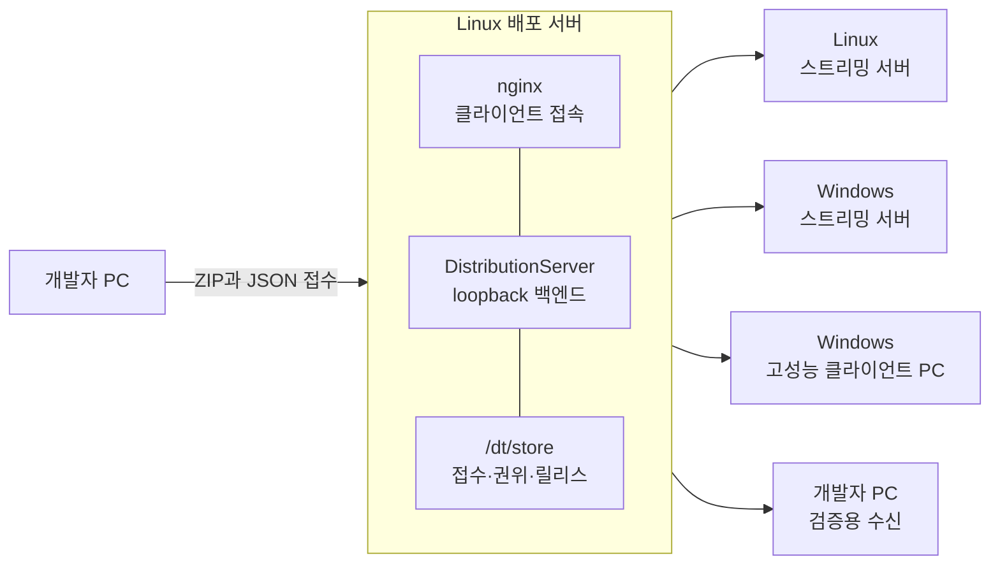
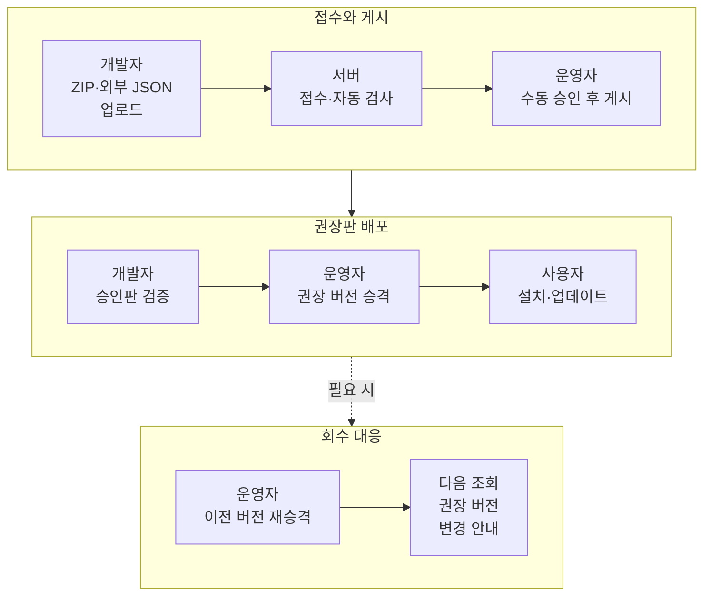
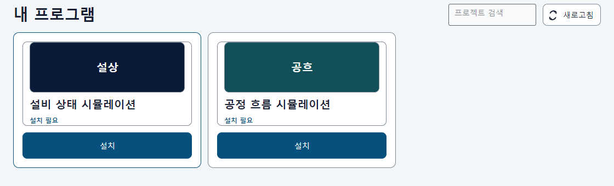
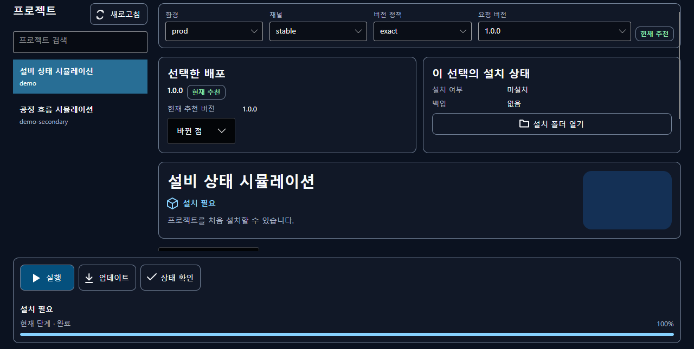

# UE-DT Launcher

권한이 있는 Windows·Linux 환경에 Unreal Engine 디지털 트윈을 배포하고, 설치·업데이트·실행하는 런처입니다.

| 실행 환경 | 런처 형태 | 받는 채널 | 안내 문서 |
|---|---|---|---|
| Linux 스트리밍 서버 | Linux x64 CLI. 필요 시 systemd Agent로 관리형 설치 요청 | `stable` 추천판 | [서비스 모드](docs/reference/service-mode.md) |
| Windows 스트리밍 서버 | Windows x64 CLI 또는 GUI. 관리형은 업데이트 서비스(Agent)로 설치 | `stable` 추천판 | [Windows 설치와 서비스](docs/reference/service-mode.md#windows-msi와-localservice) |
| Windows 고성능 클라이언트 PC | 일반 GUI. 관리형 또는 portable 설정 | `stable` 추천판 | [일반 사용자 한 장 안내](docs/reference/launcher-user-guide.md#일반-사용자-한-장-안내) |
| 개발자 PC | 클라이언트 PC와 같은 구성에 별도 개발자 GUI와 배포 CLI 사용 | 권한 있는 `stable`·`dev`·`beta`. 승인된 특정 버전을 선택해 검증 | [개발자 선택과 복구](docs/reference/launcher-user-guide.md#개발자-선택복구) |

위 표의 채널은 운영 예시이며 회사 파일럿 정책은 `stable` 단일 채널입니다. 개발자 화면은 PC에 부여된 서버 권한 범위에서 버전을 보여줍니다. 회사 서버·PC 인수는 예정 상태입니다. [실환경 이관 체크리스트](docs/reference/commercial-deployment.md#실환경-이관-체크리스트)

## 전체 구성

nginx를 통해 허용된 PC가 Catalog·파일을 받습니다. 관리형에서는 업데이트 서비스가 설치하고, 런처는 사용자 세션에서 앱을 실행합니다.

## 배포 흐름

승인과 승격을 따로 진행합니다. 이전 버전을 다시 권장해도 파일이나 실행 중인 앱은 자동으로 전환되지 않습니다.

## 역할별 빠른 시작

### 서버 관리자

1. 승인된 RHEL 번들을 준비합니다. systemd 사용자 서비스를 선택하면 설치 전에 linger와 사용자 bus를 준비합니다.
2. `dt2prod`로 `./dt-setup.sh check`, `./dt-setup.sh install`을 실행합니다. `./dt-setup.sh admin-request`를 전달하면 root 담당자가 기존 nginx 설정을 적용합니다.
3. `./dt-setup.sh verify` 후 PC 공개키와 허용 정책을 등록합니다. [서버 설치와 관리자 인계](docs/reference/distribution-workflow.md#dt2prod-설치와-nginx-전환) · [PC 등록](docs/reference/intranet-auth.md)

### 개발자

1. OS별 패키지 ZIP과 업로드 프로필을 준비합니다. 전용 SSH 계정이 승인된 환경에서 `upload`로 제출합니다.
2. `upload status --profile upload.profile.json --upload-id <ID> --wait`로 접수를 확인하고 운영자가 서버 콘솔에서 승인합니다.
3. 개발자 런처에서 허용된 정확한 버전을 검증합니다. 운영자가 콘솔에서 해당 버전을 권장판으로 승격합니다. [개발자·운영자 배포 단계](docs/reference/feature-workflow.md#b-새-버전마다-zip--승인된-배포)

### 사용자

1. 담당자가 제공한 런처를 설치하고 일반 GUI를 엽니다.
2. 프로그램을 선택하고 화면에 표시된 **설치**, **업데이트** 또는 **실행** 버튼을 누릅니다.
3. 오류가 발생하면 **지원 정보 복사**를 눌러 담당자에게 전달합니다. [일반 사용자 안내](docs/reference/launcher-user-guide.md#일반-사용자-한-장-안내)

## 화면 예시

합성 프로젝트를 사용한 Windows 시험 화면입니다.

## 문서 색인

| 하려는 일 | 문서 |
|---|---|
| 최초 준비부터 배포·실행·장애 대응까지 확인 | [단계별 기능 지도](docs/reference/feature-workflow.md) |
| RHEL 서버 설치·승인·승격·백업 운영 | [배포 서버 운영](docs/reference/distribution-workflow.md) |
| 사내 HTTP 인증과 PC 등록 | [요청 서명·초기 준비](docs/reference/intranet-auth.md) |
| 빌드·게시, 설정 또는 CLI 명령 조회 | [빌드·검증](docs/reference/feature-workflow.md#a1-실행-프로그램-만들기--개발-pc-저장소-루트) · [설정·CLI 레퍼런스](docs/reference/guide-03-launcher-usage.md) |
| 프로그램 설치·실행·복구 | [사용자 가이드](docs/reference/launcher-user-guide.md) |
| 화면의 이름·이미지·표시 설정 | [UI 커스터마이징](docs/reference/launcher-ui-customization.md) |
| 실행 중 변경 차단·수동 복구 | [실행 안전성](docs/reference/runtime-safety.md) |
| Agent·무인 점검·서비스 실행 설정 | [서비스 모드](docs/reference/service-mode.md) |
| MSI/RPM 제작과 회사 이관 | [설치본·운영 인수](docs/reference/commercial-deployment.md) |
| 개발용 Windows PC에서 로컬 ZIP 접수와 LAN 배포 시험 | [Windows 배포 시험 가이드](docs/reference/windows-lab/README.md) |
| 목표·진척·검증 근거 확인 | [프로젝트 목표](PROJECT_GOALS.md) · [개선 대장](IMPROVEMENTS.md) · [검증 이력](docs/reference/archive/README.md) |
| 문서 전체 탐색과 기여 규칙 확인 | [참고 문서 모음](docs/reference/README.md) · [개발 규칙](AGENTS.md) |
