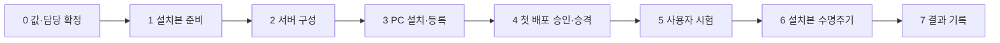

# 관리형 배포·패키징 준비

> 현재 가이드 / 문서 점검 2026-10-03 / codex/operations-hardening-closure. 현재 기능은 [README](../../README.md), 미완료 항목은 [보완 목록](../../IMPROVEMENTS.md)을 따릅니다.

현재 기본 경로는 DistributionServer의 ZIP + 외부 `release.json` 접수·승인 → 서버 권한 확인 → 서명된 메타데이터/파일 다운로드 → 버전별 설치입니다. 서버·토큰 준비는 [통합 운영](distribution-workflow.md)을 따릅니다.

이 문서는 패키징 소스와 현장 점검 절차입니다. MSI machine-wide 설치·실제 RHEL 8 RPM 배포·실제 UE 운영 검증 완료를 뜻하지 않습니다. 초기 통합 결과는 [배포 이력](archive/validation/distribution-validation.md), 최신 합성 앱 실행·복구·rollback 결과는 [관리형 GUI 이력](archive/validation/managed-gui-safety-validation.md)을 따릅니다. 문서 점검이 새 설치 수명주기 시험을 뜻하지 않습니다.

## 회사 시범 환경 구축 — 단계별 안내

회사 서버 1대와 회사 Windows PC 1~2대로 **처음 시범 시험**을 할 때의 순서입니다. 로컬 합성 fixture나 console Agent 절차가 아니라, 실제 설치본(MSI)과 서비스 계정으로 회사 망에서 확인하는 절차입니다.

> 이 안내의 명령은 저장소 코드와 현행 가이드 기준입니다. 2026-10-13 현재 이 순서를 실제 회사 환경에서 끝까지 실행한 기록은 없습니다. 단계마다 결과를 기록해 PROJECT_GOALS의 G1~G3 근거로 사용하고, 예상과 다른 결과는 우회하지 말고 기록한 뒤 멈춥니다.

통신 방식은 사용자 확정(D-11)대로 **사내 HTTP + PC 요청 서명**(`request-signature-v1`)을 기준으로 합니다. HTTP 내용은 암호화되지 않으므로 도청·중계 위험의 운영 수용은 별도입니다. 기존 HTTPS/Bearer로 시험하려면 [통합 운영](distribution-workflow.md)을 따릅니다.

| 단계 | 담당 | 장소 | 끝나면 확인되는 것 |
|---:|---|---|---|
| 0 | 시범 책임자 | 회의 | 값·담당자·시험 PC·복구 방법 확정 |
| 1 | 개발 담당 | 개발 PC | 시험할 설치본·서버 프로그램·서명키·인수 계획 |
| 2 | 서버 관리자 | 회사 Linux 서버 | 배포 서버 서비스·nginx·방화벽 동작 |
| 3 | PC 관리자 + 서버 관리자 | 회사 Windows PC | MSI 설치, Agent 서비스, PC 키 등록, 온라인 점검 |
| 4 | 개발 담당 + 배포 관리자 | 개발 PC → 서버 | 첫 시험 버전 접수·승인·승격 |
| 5 | 일반 사용자 계정 | 회사 Windows PC | 설치·실행·업데이트·복구·권한 거부 |
| 6 | PC 관리자 | 시험 PC 또는 VM | MSI 업그레이드·repair·재부팅·제거 |
| 7 | 시범 책임자 | — | 결과 기록과 진행 대장 반영 |



### 0단계. 시작 전에 정할 값과 준비물

아래 기호는 이 안내의 모든 명령에 나옵니다. 실제 값으로 바꿔 한 장에 적어 두고 시작합니다. 예시값을 그대로 쓰지 않습니다.

| 기호 | 의미 | 예시 (바꿀 값) | 정하는 사람 |
|---|---|---|---|
| `<SERVER_IP>` | 배포 서버의 사내 IP 또는 이름 | `10.20.30.40` | 서버 관리자 |
| `<PROJECT_ID>` | DT 프로그램의 프로젝트 ID | `ue-dt-simulator` | 개발 담당 |
| `<PC_ID>` | 시험 PC 식별자 | `pc-001` | 배포 관리자 |
| `<PC_IP>` | 서버가 보는 시험 PC의 IP (고정 또는 예약) | `10.20.40.15` | 네트워크 담당 |
| `<KEY_ID>` | PC 요청 키 ID. 교체할 때 바뀌도록 버전을 붙임 | `pc-001-v1` | 배포 관리자 |
| `<VERSION>` / `<NEXT_VERSION>` | 첫 시험 버전 / 업데이트 시험 버전 | `1.0.0` / `1.0.1` | 개발 담당 |
| `<UPLOADER>` | ZIP 업로드 전용 Linux 계정 | `uploader` | 서버 관리자 |

준비물 점검:

- [ ] **시범 승인**: 운영 중인 업무 PC가 아닌 시험 PC(또는 VM)를 쓰고, 담당자와 시험 기간이 정해졌다.
- [ ] **복구 수단**: 시험 PC·서버의 VM snapshot 또는 백업이 있다. 6단계(제거·재설치)는 snapshot이 있는 VM에서 하는 것을 권장한다.
- [ ] **서버**: 회사 표준 RHEL 8 계열, sudo 권한, nginx 패키지, ZIP 원본·검사 사본·게시본을 함께 둘 디스크 여유.
- [ ] **PC**: Windows 10/11 x64, 로컬 관리자 계정 1개와 **관리자가 아닌 일반 사용자 계정 1개**. 일반 계정이 있어야 서비스 계정·ACL 문제가 드러난다.
- [ ] **망**: PC → 서버 `80/tcp` 허용, 서버의 `18500/tcp`는 외부 차단. 서버가 보는 PC IP가 프록시·NAT로 바뀌지 않는지 네트워크 담당이 확인했다.
- [ ] **개발 PC**: .NET 8 SDK, Python 3.10 이상, PowerShell. MSI 빌드는 WiX SDK를 NuGet으로 받으므로 패키지 저장소에 접근할 수 있어야 한다.
- [ ] **시험용 ZIP**: Unreal로 패키징한 Windows ZIP 2개(`<VERSION>`, `<NEXT_VERSION>`). 실제 패키지가 아직 없으면 먼저 작은 시험 앱으로 1~5단계를 확인한 뒤 실제 패키지로 반복한다.
- [ ] **코드서명 인증서**: 있으면 공식 서명 MSI로 시험한다. 없으면 `UNSIGNED-DEV` MSI로 시험하되, 그 결과는 G1의 서명 항목 통과로 기록하지 않는다.

### 1단계. 개발 PC — 시험용 설치본과 서버 프로그램 만들기

저장소 루트의 PowerShell에서 실행합니다. 시험에 쓴 커밋을 기록하기 위해 먼저 상태를 확인합니다.

```powershell
git fetch origin
git switch main
git pull --ff-only
git status --short          # 출력이 없어야 함
git rev-parse HEAD          # 이 값을 시험 기록에 적음
dotnet restore UeDtLauncher.sln
```

**1-1. 배포 서버 프로그램 (Linux용)**

```powershell
dotnet publish src/UeDtLauncher.DistributionServer -c Release -r linux-x64 --self-contained true -o artifacts/pilot/distribution-server
```

결과: `artifacts/pilot/distribution-server/` 폴더 전체를 서버로 옮깁니다. 실행 파일 하나만 옮기지 않습니다.

**1-2. Windows 설치본 (MSI)**

```powershell
# 일반 사용자용 (일반 GUI + Agent)
.\scripts\build-windows-installer.ps1 -Version <VERSION>
# 개발자 PC도 시험하면 (일반 + 개발자 GUI + Agent)
.\scripts\build-windows-installer.ps1 -Version <VERSION> -Edition Developer
```

- 출력은 `artifacts/windows-installer/runs/<실행ID>/release`이며, 같은 폴더의 `package-result.json`이 가리키는 MSI만 사용합니다. 예전 실행 폴더의 MSI를 섞지 않습니다.
- 인증서가 준비됐다면 `-OfficialBuild`를 붙입니다. 이 경우 EXE 서명 → MSI 생성·서명 → 내장 EXE 서명 대조가 통과해야 결과가 나옵니다.
- 6단계 업그레이드 시험용으로 `<NEXT_VERSION>` MSI도 같은 방법으로 만들어 둡니다.

```powershell
Get-FileHash <MSI 경로> -Algorithm SHA256   # 시험 기록에 적음
```

**1-3. 배포 서명키 (처음 한 번만)**

이미 운영 중인 서명키가 있으면 새로 만들지 않습니다. 처음이라면 빈 폴더에서 만듭니다.

```powershell
New-Item -ItemType Directory -Force "$env:USERPROFILE\DT-Deploy\keys" | Out-Null
dotnet publish src/UeDtLauncher/UeDtLauncher.csproj -c Release -r win-x64 --self-contained true -o artifacts/pilot/client-win-x64
$Launcher = (Resolve-Path .\artifacts\pilot\client-win-x64\UeDtLauncher.exe).Path
& $Launcher generate-signing-key --private-key "$env:USERPROFILE\DT-Deploy\keys\release-private.pem" --public-key "$env:USERPROFILE\DT-Deploy\keys\release-public.pem"
```

- `release-private.pem`(개인키)은 서버 관리자에게만 안전한 경로로 전달하고 개발 PC에서는 지웁니다. 메일·메신저·Git에 올리지 않습니다.
- `release-public.pem`(공개키)은 3단계에서 PC에 배치합니다.
- 이 키는 PC 요청 서명 키(3단계)나 코드서명 인증서와 다른 용도입니다.
- `$Launcher`는 4단계의 `release-metadata`에도 사용합니다.

**1-4. 인수 체크리스트 생성 (실행하지 않는 도구)**

```powershell
python tools/prepare-company-acceptance.py --platform windows --package <MSI 경로> --next-package <NEXT_VERSION MSI 경로> --output <새 빈 폴더>
```

설치·서비스·재부팅을 실행하지 않고, 설치본 SHA-256과 6단계용 점검 목록만 만듭니다. 시험 기록과 함께 보관합니다.

### 2단계. 회사 Linux 서버 — 배포 서버 구성

서버 관리자가 sudo 권한으로 실행합니다. 계정·폴더 명령은 예시이며, 회사 보안 기준(계정 명명, ACL 방식)이 있으면 그것을 따릅니다.

**2-1. 서비스 계정과 폴더**

```bash
sudo useradd --system --home-dir /srv/ue-dt-distribution --shell /sbin/nologin uedt-distribution
sudo mkdir -p /opt/ue-dt-distribution /etc/ue-dt-distribution /srv/ue-dt-distribution/incoming
sudo chown -R uedt-distribution:uedt-distribution /srv/ue-dt-distribution
sudo chmod 0750 /srv/ue-dt-distribution
```

업로드 계정은 `incoming`에만 쓸 수 있어야 하고, 서비스 계정은 업로드된 파일을 읽을 수 있어야 합니다. 예시(ACL 사용 시):

```bash
sudo setfacl -m u:<UPLOADER>:x /srv/ue-dt-distribution
sudo setfacl -m u:<UPLOADER>:rwx /srv/ue-dt-distribution/incoming
sudo setfacl -d -m u:uedt-distribution:rwx /srv/ue-dt-distribution/incoming
```

확인: `<UPLOADER>`로 로그인해 `incoming` 밖(예: DB·processing)을 읽거나 쓸 수 없어야 합니다.

**2-2. 프로그램과 서명 개인키 배치**

```bash
# 1-1의 폴더 전체를 서버로 복사한 뒤
sudo cp -r ./distribution-server/. /opt/ue-dt-distribution/
sudo chmod 0755 /opt/ue-dt-distribution/UeDtLauncher.DistributionServer
sudo install -o uedt-distribution -g uedt-distribution -m 0600 ./release-private.pem /etc/ue-dt-distribution/release-private.pem
```

**2-3. 서버 설정 `/etc/ue-dt-distribution/server.json`**

```json
{
  "root": "/srv/ue-dt-distribution",
  "publicUrl": "http://<SERVER_IP>",
  "listenUrl": "http://127.0.0.1:18500",
  "authenticationMode": "request-signature-v1",
  "signingKeyPath": "/etc/ue-dt-distribution/release-private.pem",
  "signingKeyId": "release-1",
  "policyPath": "/etc/ue-dt-distribution/access-policy.json",
  "limits": {"maxExpandedBytes": 536870912000, "maxFiles": 250000, "maxZipBytes": 214748364800}
}
```

- `publicUrl`은 PC가 실제로 접속하는 주소와 정확히 같아야 합니다(요청 서명 결속에 사용).
- `limits`는 실제 패키지 크기와 디스크에 맞게 줄이거나 늘립니다.
- `signingKeyId`는 3단계 PC 설정의 `--signing-key-id`와 같아야 합니다.

**2-4. 접근 정책 `/etc/ue-dt-distribution/access-policy.json`**

처음에는 비어 있는 정책으로 시작하고, 3단계에서 PC 키를 등록한 뒤 PC를 추가합니다.

```json
{"clients":[]}
```

```bash
sudo chown root:uedt-distribution /etc/ue-dt-distribution/server.json /etc/ue-dt-distribution/access-policy.json
sudo chmod 0640 /etc/ue-dt-distribution/server.json /etc/ue-dt-distribution/access-policy.json
```

**2-5. 서비스 등록**

저장소의 `packaging/linux/ue-dt-distribution.service`를 서버로 옮겨 설치합니다.

```bash
sudo cp ue-dt-distribution.service /etc/systemd/system/
sudo systemctl daemon-reload
sudo systemctl enable --now ue-dt-distribution
sudo systemctl status ue-dt-distribution --no-pager
```

정상: `active (running)`. 실패하면 `sudo journalctl -u ue-dt-distribution -n 100 --no-pager`로 원인을 확인합니다.

**2-6. nginx와 방화벽**

저장소의 `packaging/linux/distribution-nginx-http-signature.conf`에서 `server_name 10.20.30.40;`을 `<SERVER_IP>`로 바꿔 배치합니다. 이 설정은 인증 API와 `releases/` 경로만 backend로 넘기고 나머지는 404입니다. 공개 정적 폴더(alias/root)를 추가하지 않습니다.

```bash
sudo cp distribution-nginx-http-signature.conf /etc/nginx/conf.d/ue-dt-distribution.conf
sudo nginx -t
sudo systemctl enable --now nginx
sudo systemctl reload nginx
sudo firewall-cmd --permanent --add-service=http
sudo firewall-cmd --reload
sudo firewall-cmd --list-all        # 18500이 열려 있지 않아야 함
getenforce                           # Enforcing이면 아래 확인
sudo setsebool -P httpd_can_network_connect 1   # SELinux가 nginx→127.0.0.1:18500 연결을 막는 경우에만, 보안 담당 승인 후
```

**2-7. 서버 확인**

```bash
curl -s -o /dev/null -w '%{http_code}\n' http://<SERVER_IP>/api/v1/catalog     # 401 예상 (서명 없는 요청 거부)
curl -s -o /dev/null -w '%{http_code}\n' http://<SERVER_IP>/                   # 404 예상
```

다른 PC에서 `http://<SERVER_IP>:18500`에 접속되면 방화벽을 고친 뒤 진행합니다. 첫 요청이 `200`이면 인증이 꺼진 것이므로 즉시 멈추고 `authenticationMode`를 확인합니다. `502`는 서비스 미기동 또는 SELinux 차단입니다.

### 3단계. 회사 Windows PC — 설치와 등록

PC 관리자 계정으로 로그인해 **관리자 PowerShell**에서 실행합니다. 시작 전에 snapshot을 만들거나 현재 상태를 기록합니다.

**3-1. MSI 설치**

```powershell
New-Item -ItemType Directory -Force C:\Temp | Out-Null
msiexec /i "<MSI 경로>" /l*v C:\Temp\ue-dt-install.log
Get-Service UeDtLauncherAgent
```

정상 결과:

| 확인 | 정상 |
|---|---|
| 프로그램 폴더 | `C:\Program Files\UE-DT Launcher\`에 `UeDtLauncher.exe`, `UeDtLauncher.Agent.exe`(개발자판은 `UeDtLauncher.Developer.exe` 추가), `BUILD-INFO.txt`, `launcher.config.example.json` |
| 데이터 폴더 | `C:\ProgramData\UE-DT Launcher\`에 `config`, `state`, `apps`, `logs`, `credentials` |
| 서비스 | `UeDtLauncherAgent`, 시작 유형 자동, 계정 `NT AUTHORITY\LocalService` |

- `UNSIGNED-DEV` MSI는 SmartScreen·게시자 경고가 나옵니다. 경고 화면을 캡처해 기록하고, 이 결과로 서명 항목을 통과 처리하지 않습니다.
- MSI는 시작 메뉴·바탕화면 바로가기를 만들지 않습니다. 사용자 시험에는 3-6의 바로가기를 관리자가 만들어 줍니다.

**3-2. PC 요청 키 생성**

```powershell
cd "C:\Program Files\UE-DT Launcher"
.\UeDtLauncher.exe credential keygen --name ue-dt-device --key-id <KEY_ID> --public-out C:\Temp\<PC_ID>-public.json
.\UeDtLauncher.exe credential status --name ue-dt-device
```

개인키는 PC의 보호 저장소에 남고, `C:\Temp\<PC_ID>-public.json`에는 공개키만 들어 있습니다. 이 JSON만 서버 관리자에게 전달합니다.

**3-3. 서버에 PC 공개키와 권한 등록 (서버 관리자)**

```bash
sudo -u uedt-distribution /opt/ue-dt-distribution/UeDtLauncher.DistributionServer client-key add --client <PC_ID> --public-key /tmp/<PC_ID>-public.json --config /etc/ue-dt-distribution/server.json
sudo -u uedt-distribution /opt/ue-dt-distribution/UeDtLauncher.DistributionServer client-key list --config /etc/ue-dt-distribution/server.json
```

정책에 PC를 추가합니다. 임시 파일에 작성하고 `mv`로 교체합니다(정책은 요청마다 다시 읽힘).

```json
{"clients":[
  {"id":"<PC_ID>","addresses":["<PC_IP>"],"grants":[
    {"projectId":"<PROJECT_ID>","environment":"prod","channel":"stable","versions":[]}
  ]}
]}
```

```bash
sudo install -o root -g uedt-distribution -m 0640 /tmp/access-policy.new.json /etc/ue-dt-distribution/access-policy.json.tmp
sudo mv /etc/ue-dt-distribution/access-policy.json.tmp /etc/ue-dt-distribution/access-policy.json
```

**3-4. Agent 운영 설정 배치 (PC 관리자)**

1단계의 `release-public.pem`을 `C:\ProgramData\UE-DT Launcher\config\release-public.pem`으로 복사합니다. 그다음 운영 설정을 만들어 검토한 뒤 배치합니다.

```powershell
.\UeDtLauncher.exe sample-config --server-url http://<SERVER_IP> --project-id <PROJECT_ID> --platform windows-x64 --profile general --credential-name ue-dt-device --signing-key-id release-1 --public-key release-public.pem --output C:\Temp\launcher.config.json
notepad C:\Temp\launcher.config.json
Copy-Item C:\Temp\launcher.config.json "C:\ProgramData\UE-DT Launcher\config\launcher.config.json"
Restart-Service UeDtLauncherAgent
```

이미 같은 위치에 설정이 있으면 덮어쓰기 전에 백업합니다.

**3-5. 온라인 점검**

```powershell
.\UeDtLauncher.exe doctor --config "C:\ProgramData\UE-DT Launcher\config\launcher.config.json" --online --format text
.\UeDtLauncher.exe agent status
```

- credential·공개키·인증·서명 검사가 통과해야 합니다.
- 아직 게시한 버전이 없으므로 "허용된 배포 없음"·"추천 대기"는 정상입니다. 인증 실패(401)·접근 거부(403)와 구분합니다.
- `healthy=true`나 종료 코드 0만으로 설치·실행 가능을 판단하지 않습니다. 준비도 `action-required` / `verification-pending` / `checks-passed`를 함께 봅니다.

**3-6. 사용자 화면 설정과 바로가기**

GUI는 `--config`로 지정한 파일 또는 실행 파일 옆 `launcher.config.json`만 읽습니다. 화면 설정에는 선택 정보만 들어가며 서버 주소·키는 들어가지 않습니다.

```powershell
.\UeDtLauncher.exe sample-config --mode managed-client --project-id <PROJECT_ID> --platform windows-x64 --output "C:\Program Files\UE-DT Launcher\launcher.config.json"
```

바탕화면 바로가기를 만들 때 대상은 `"C:\Program Files\UE-DT Launcher\UeDtLauncher.exe"`(개발자는 `UeDtLauncher.Developer.exe`)로 지정합니다.

### 4단계. 첫 시험 버전 올리기

상세 설명은 [기능 지도 B](feature-workflow.md)와 같습니다. 여기서는 순서만 요약합니다.

**4-1. 개발 PC — 외부 release.json 생성**

```powershell
& $Launcher release-metadata --zip "<ZIP 경로>" --project-id <PROJECT_ID> --display-name '<표시 이름>' --version <VERSION> --environment prod --channel stable --platform windows-x64 --payload-root <ZIP 안 프로그램 폴더> --entry-point <실행 파일.exe> --output "<ZIP 폴더>\release.json"
```

**4-2. 업로드** — 새 폴더 `/srv/ue-dt-distribution/incoming/<업로드 ID>/`에 `*.uploading` 이름으로 두 파일을 올리고, 둘 다 끝난 뒤 최종 이름으로 바꿉니다(WinSCP 또는 [기능 지도 B3](feature-workflow.md)의 명령).

**4-3. 서버 — 검사 확인과 승인**

```bash
sudo -u uedt-distribution /opt/ue-dt-distribution/UeDtLauncher.DistributionServer list --config /etc/ue-dt-distribution/server.json
sudo -u uedt-distribution /opt/ue-dt-distribution/UeDtLauncher.DistributionServer inspect <JOB_ID> --config /etc/ue-dt-distribution/server.json
# inspect의 snapshot 경로 안 release.json 내용을 확인한 뒤
sudo -u uedt-distribution /opt/ue-dt-distribution/UeDtLauncher.DistributionServer approve <JOB_ID> --config /etc/ue-dt-distribution/server.json
```

**4-4. 서버 — 첫 승격**

```bash
sudo -u uedt-distribution /opt/ue-dt-distribution/UeDtLauncher.DistributionServer promotion inspect --project-id <PROJECT_ID> --environment prod --channel stable --platform windows-x64 --config /etc/ue-dt-distribution/server.json
sudo -u uedt-distribution /opt/ue-dt-distribution/UeDtLauncher.DistributionServer promote --project-id <PROJECT_ID> --environment prod --channel stable --platform windows-x64 --version <VERSION> --expected-revision 0 --reason '회사 시범 첫 버전' --config /etc/ue-dt-distribution/server.json
```

승인만으로는 PC에 추천되지 않습니다. 첫 버전도 승격해야 합니다.

### 5단계. 회사 PC — 일반 사용자 계정으로 시험

관리자 계정에서 로그아웃하고 **일반 사용자 계정**으로 로그인합니다. 각 항목의 결과(통과/실패/미실행), 화면 캡처, 시각을 기록합니다.

| 번호 | 시험 | 방법 | 기대 결과 |
|---:|---|---|---|
| 5-1 | 최초 상태 | 바로가기로 런처 실행 | 서버 연결·`<VERSION>` 설치 안내. 오류 시 지원 ID 표시 |
| 5-2 | 설치 | 주 버튼으로 설치 | 진행 표시 후 완료. 설치 위치 `C:\ProgramData\UE-DT Launcher\apps\...` |
| 5-3 | 실행 | 주 버튼으로 실행 | DT 프로그램 실행. 실제 UE는 화면·입력·저장이 정상인지 확인 |
| 5-4 | 런처 종료 | 실행 중 런처 창 닫기 | DT 프로그램은 계속 실행 |
| 5-5 | 실행 중 변경 차단 | 실행 중 `<NEXT_VERSION>`을 4단계 순서로 승인·승격 → 런처 다시 열기 | 업데이트·복구 버튼 차단, 프로그램 종료 후 가능 |
| 5-6 | 업데이트 | 프로그램 종료 후 업데이트 → 실행 | `<NEXT_VERSION>` 실행, 이전 버전 폴더 보존 |
| 5-7 | 문제 해결 | (관리자) 설치 폴더의 파일 하나를 손상 → 사용자 문제 해결 | 손상 파일만 복구, 정상 설치는 점검만 |
| 5-8 | 사용자 데이터 | 실제 UE에서 저장 → 업데이트·복구 후 확인 | 저장 데이터 유지. 데이터 위치를 기록 |
| 5-9 | 재부팅 | PC 재부팅 → 런처 실행 | 서비스 자동 시작, 상태 정상 |
| 5-10 | 권한 거부 | (서버) 정책에서 grants 비우기 → 런처 다시 확인 | "허용된 배포 없음" 안내, 설치·실행 불가 |
| 5-11 | 키 폐기 | (서버) `client-key revoke --key-id <KEY_ID>` → 런처 확인 | 인증 실패 안내. Bearer·무인증으로 넘어가지 않음 |
| 5-12 | 다른 IP | (서버) 정책의 `addresses`를 시험 PC가 아닌 IP로 바꾼 뒤 런처 확인 | 접근 거부(403) |
| 5-13 | 지원 자료 | (관리자) `diagnostics export --config <운영 설정>` | 비밀·사용자 경로가 제거된 ZIP 생성 |

- 5-10·5-12 뒤에는 정책을 원래대로 되돌립니다. 5-11로 폐기한 키는 되살리지 않고, [키 교체 순서](intranet-auth.md)대로 새 이름·새 key ID(예: `pc-001-v2`)로 만들어 등록하고 운영 설정의 credential 이름을 바꾼 뒤 정상 동작을 다시 확인합니다.
- 5-7의 파일 손상은 시험 PC에서만 합니다.

### 6단계. 설치본 수명주기 (가능하면 snapshot 있는 VM)

1-4에서 만든 체크리스트 순서로 실행합니다. 각 단계 전에 snapshot을 만듭니다.

```powershell
msiexec /i "<NEXT_VERSION MSI 경로>" /l*v C:\Temp\ue-dt-upgrade.log   # 업그레이드
msiexec /fa "<NEXT_VERSION MSI 경로>" /l*v C:\Temp\ue-dt-repair.log   # repair
Restart-Computer                                                       # 재부팅 후 서비스·런처 확인
msiexec /x "<NEXT_VERSION MSI 경로>" /l*v C:\Temp\ue-dt-uninstall.log # 제거
```

단계마다 확인할 것:

- `C:\ProgramData\UE-DT Launcher\config\launcher.config.json`(운영 설정)과 PC 키가 유지되는가
- `apps`의 설치된 DT 프로그램과 `state`가 유지되는가, 런처가 다시 인식하는가
- 사용자 저장 데이터가 유지되는가
- 같은 버전을 다른 에디션(일반↔개발자)으로 덮어 설치하면 안내와 함께 거부되는가
- 제거 후 서비스가 사라지고, 무엇이 남는지(데이터 폴더 등) 기록

### 7단계. 결과 기록과 반영

시험이 끝나면 아래를 한 문서에 정리합니다. 비밀(개인키·토큰)과 사용자 이름이 들어간 경로는 적지 않습니다.

| 기록 | 내용 |
|---|---|
| 환경 | 날짜, 서버 OS 버전, PC Windows 버전·빌드, 망 구성(프록시 여부) |
| 대상 | 커밋(`git rev-parse HEAD`), MSI 파일명·SHA-256, 서명 여부(`UNSIGNED-DEV`/공식) |
| 결과 | 3단계·5단계·6단계 항목별 통과/실패/미실행과 캡처, 실패 시 지원 ID·로그 |
| 판단 | 아래 표의 근거 충족 여부 |

| 시범 결과 | 연결되는 승인 조건·항목 |
|---|---|
| 서명 MSI 설치, 서비스 계정, 실행 중 변경 차단 | G1 / OPS-02·08·09, SEC-03 |
| PC 키·IP 허용/거부, 키 폐기 | G2 / SEC-01·02·04 |
| 실제 UE 접수→설치→실행→업데이트→복구, 저장 데이터 | G3 / OPS-01, USER-01 |
| 업그레이드·repair·재부팅·제거 | G5 / OPS-02 |

결과 문서는 `docs/reference/archive/validation/`에 새 파일로 추가하고, [IMPROVEMENTS](../../IMPROVEMENTS.md)의 해당 항목 진행률·근거·남은 조건을 증거 범위만큼만 갱신합니다. 시험 PC 1대의 결과를 전사 운영 승인(G6)으로 확대하지 않습니다.

### 시험 중 문제가 생기면

| 증상 | 먼저 볼 곳 |
|---|---|
| 서버 서비스가 바로 종료 | `journalctl -u ue-dt-distribution`, server.json 경로·권한, 개인키 0600·소유자 |
| nginx 502 | `systemctl status ue-dt-distribution`, SELinux(`getenforce`, `/var/log/audit/audit.log`) |
| PC에서 연결 실패 | PC → `<SERVER_IP>:80` 방화벽, `publicUrl` 철자 |
| 401 인증 실패 | `client-key list`의 key ID·폐기 여부, PC `credential status`, `signingKeyId` 일치 |
| 403 접근 거부 | 서버가 본 PC IP(NAT·프록시)와 정책 `addresses`, grants의 프로젝트·환경·채널 |
| 허용 배포 없음 | 승인 여부, 첫 승격 여부, Windows용(`windows-x64`) 게시 여부 |
| Agent 서비스 시작 실패 | 이벤트 뷰어 > Windows 로그 > 응용 프로그램, `C:\ProgramData\UE-DT Launcher\logs` |
| 일반 사용자만 실패 | `ProgramData\UE-DT Launcher` 폴더 ACL(Users 읽기·실행), credential 접근 |

검사 옵션을 끄거나, 정책을 넓게 열거나, Bearer·무인증으로 바꿔서 통과시키지 않습니다. 기존 [문제 해결 표](intranet-auth.md)와 [실행 안전성](runtime-safety.md)도 함께 참고합니다.

### 시험 후 정리

1. 서버: `client-key revoke --key-id <KEY_ID>`, 정책에서 시험 PC 제거.
2. PC: `msiexec /x`로 제거 또는 snapshot 복원.
3. 시험용으로 만든 서명 개인키를 운영에 쓰지 않을 경우 폐기하고, 운영용 키는 별도로 만듭니다.
4. 서버를 운영으로 이어 쓸 경우 [오프라인 백업](distribution-workflow.md)을 먼저 만듭니다.

## 책임과 계정

GUI는 사용자 세션에서 앱을 실행하고 Agent는 보호 설정으로 설치·복구·백업 복원을 수행합니다. IPC는 Windows named pipe 또는 Linux Unix socket입니다. DistributionServer에서는 서버 grant가 권한을 결정합니다. 레거시 정적 catalog Agent는 관리 설정에 선언된 프로젝트로 제한됩니다.

Windows MSI의 Agent 계정은 `NT AUTHORITY\LocalService`, Linux unit은 `uedt`입니다. 설정·credential·공개키의 소유권/ACL, 앱 실행 계정의 읽기·실행 권한을 별도로 점검합니다.

## 빌드 진입점

Windows 개발 패키지:

```powershell
.\scripts\build-windows-installer.ps1 -Version 1.0.0
.\scripts\build-windows-installer.ps1 -Version 1.0.0 -Edition Developer
```

기본은 `UNSIGNED-DEV`입니다. 출력은 `artifacts/windows-installer/runs/<실행ID>/release`이며 성공한 `package-result.json`의 정확한 파일만 사용합니다. `-OfficialBuild`는 publish 전 인증서/개인키/EKU/유효기간/도구를 확인하고 EXE 선서명·검증, MSI 생성·서명·검증, CAB payload 비교를 강제합니다. 개발 빌드는 인증서 환경변수만으로 공식 빌드로 승격되지 않습니다.

General MSI는 일반 EXE/Agent, Developer MSI는 일반/개발자 EXE/Agent를 포함합니다. 같은 제품 계열의 동일 버전 다른 설치본을 중복 설치하려 하면 전환 안내로 거부하며, 관리자 정비 후 재설치 또는 새 버전 업그레이드로 전환합니다. 내용/설정/state/사용자 데이터 보존은 실제 VM 인수에서 확인해야 합니다. 에디션은 설정에서 선택하지 않습니다.

Linux RPM:

```bash
./scripts/build-rpm.sh 1.0.0
```

출력은 `artifacts/linux-rpm/run.<고유ID>/artifacts/`이며 스크립트의 `RPM_PATH`와 `package-result.json`으로 이번 실행의 정확한 RPM을 선택합니다. 예전 산출물을 wildcard로 다시 서명하지 않습니다. `rpmbuild`, `rpm2cpio`, Python3.10+가 필요합니다. spec은 번들 strip·중복 build-id 링크를 막고 설정을 `%config(noreplace)`로 보존합니다. data-only CAB/RPM 추출과 GUI·Agent hash/권한 확인까지 성공해야 공개합니다. RPM 원본 검증 결과는 `UNSIGNED-DEV`이며 실제 서명 후 CI가 별도로 검증해야 합니다.

동시에 `ue-dt-launcher-developer` 추가 RPM을 생성하며 정확히 같은 version-release의 `ue-dt-launcher`를 요구합니다. 기본 RPM은 일반/runtime-host/Agent/config/service, 추가 RPM은 개발자 EXE만 소유합니다. 개발자 배포에는 두 RPM을 사용하며 서비스가 두 번 설치되지 않습니다.

`UE_DT_SKIP_DOTNET_PUBLISH=1` 재사용 경로는 거부합니다. 새 버전의 GUI/Agent를 항상 publish하며 예시 설정은 회사 주소/계정/권한으로 provision해야 합니다. 현재 개발 PC/WSL에서 실제 설치나 scriptlet·계정 생성을 실행한 것은 아닙니다.

`.github/workflows/release.yml`은 같은 tag source의 Windows/Linux functional gate와 Windows PFX·RPM GPG 조건을 모두 요구합니다. RPM은 정확한 primary fingerprint·격리된 GPG/RPM key DB로 검사하고 재추출한 payload를 대조합니다. SBOM·checksum은 검증된 이번 package 폴더만 사용합니다. CI 코드 연결은 실제 원격 성공이나 인증서 인수가 아닙니다.

## 회사 인수 계획 생성 — 실행하지 않는 도구

```powershell
python tools/prepare-company-acceptance.py --platform windows --package <정확한-MSI> --next-package <다음-MSI> --output <새-비공개-계획폴더>
```

Linux는 `--platform rhel8 --package <정확한-RPM>`을 사용합니다. 도구는 package SHA-256과 **미실행** 체크리스트만 생성하고 install/서비스/계정/재부팅 명령은 실행하지 않습니다. 다음 package가 없으면 upgrade는 자료 대기입니다. 승인된 격리 VM snapshot과 별도 백업을 준비한 뒤, 담당자가 각 적용 직전에 확인하고 설치→연결/권한→upgrade→repair→재부팅→uninstall·설정/콘텐츠/데이터 보존을 점검하세요. `UNSIGNED-DEV` 계획 생성은 회사 서명 합격이 아닙니다.

현재 순서는 **EXE 서명·검증 → MSI 생성·서명·검증 → 비설치 CAB 추출·EXE hash/signer 확인 → artifact 공개**입니다. 실행별 WiX intermediate를 분리하며 CI는 검증된 정확한 release 폴더만 사용합니다. 실제 개발 MSI 추출은 통과했지만 회사 인증서·설치된 EXE 검증은 미완료이므로 OPS-08은 50%입니다. [상세 기록](archive/validation/deployment-safety-validation.md)

## 현장 적용 순서

1. 격리된 관리자 테스트 PC/실제 RHEL에서 설치·업그레이드·제거를 확인합니다.
2. 보호 설정에 distributionServerUrl, 설치·상태·로그 루트, 공개키, credential 이름을 지정합니다.
3. PC 토큰을 안전하게 전달하고 Agent 계정이 읽을 수 있는 credential 저장소에 등록합니다.
4. Linux credential은 0600이므로 소유자도 확인합니다. Windows는 DPAPI LocalMachine만으로 계정 격리가 보장되지 않으므로 ACL도 확인합니다.
5. 서비스·서버 연결, 허용/거부 프로젝트·버전, 설치·repair·실제 UE 실행을 확인합니다.

```text
UeDtLauncher credential set --name company-distribution
UeDtLauncher doctor --config launcher.config.json --online
UeDtLauncher agent status
UeDtLauncher agent check --project demo
UeDtLauncher agent update --project demo
UeDtLauncher diagnostics export --config launcher.config.json
```

설정은 [클라이언트 레퍼런스](guide-03-launcher-usage.md), GUI는 [UI 가이드](launcher-ui-customization.md)를 사용합니다. Agent 설치만으로 주기 점검이 시작되지 않으며 [서비스 모드](service-mode.md)의 제한을 확인합니다.

## 기존 설치 이전

두 명령은 목적이 다릅니다.

```text
UeDtLauncher.Agent migrate --config C:\ue-dt\launcher.config.json
UeDtLauncher.Agent migrate --config C:\ue-dt\launcher.config.json --dry-run
UeDtLauncher import-install --config C:\ue-dt\launcher.config.json --destination-root C:\ue-dt\apps
UeDtLauncher import-install --config C:\ue-dt\launcher.config.json --destination-root C:\ue-dt\apps --apply
```

`migrate`는 현재 계획 출력만 지원합니다. 기존 InstallDir를 공유하는 apply는 소유권 충돌 위험으로 차단되며 config/state를 생성하지 않습니다. 기존 공유 구성이 있다면 자동 이전 대신 별도 정비 계획이 필요합니다. `import-install`은 정지 확인·잠금 후 버전 설치 루트에 검사·복사하는 별도 경로이며 원본을 삭제하지 않습니다. UE 저장 데이터 이전은 USER-01의 별도 정책 대상입니다. [수동 점검](runtime-safety.md)

## 운영 승인 전 확인

- 회사 IP/방화벽/CA/접근 정책과 실제 RHEL 적용
- 서명된 MSI/RPM 설치·업그레이드·제거 및 설치 payload 서명
- Agent 계정별 credential·IPC·파일 권한
- 실제 UE 의존성·대용량 패키지·재시작·복구·저장 데이터
- 서버 DB/서명키/릴리스 백업·복원과 sequence replay 방어

레거시 `publish-release`/정적 catalog는 기존 설치 호환 경로입니다. 새 통합 서버에 공개 /projects·/catalogs location을 섞지 않습니다. 우선순위·미완료 개선은 [IMPROVEMENTS](../../IMPROVEMENTS.md)에서 관리합니다.
